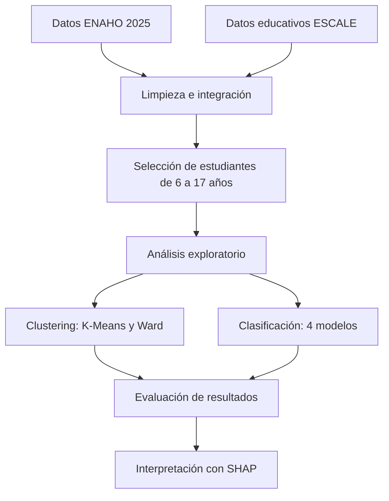

# Brecha digital y rendimiento escolar en el Perú

### Análisis exploratorio con ENAHO–ESCALE 2025

## 1. Objetivo

Analizar la relación entre las condiciones socioeconómicas, el acceso a Internet y el contexto educativo de estudiantes peruanos de 6 a 17 años, utilizando técnicas de aprendizaje automático.

**Importante:** la etiqueta utilizada representa el uso declarado de Internet, no mide directamente el rendimiento académico ni las competencias digitales.

## 2. Metodología

Se integraron datos de ENAHO 2025 y del padrón de instituciones educativas ESCALE. La base final contiene **23 668 estudiantes**, de los cuales **17 992** tienen una etiqueta disponible para el análisis supervisado.

### Flujo de trabajo



### Técnicas utilizadas

- **Clustering:** K-Means y agrupamiento jerárquico Ward, para identificar perfiles similares.
- **Clasificación:** Regresión Logística, Random Forest, Extra Trees y XGBoost.
- **Evaluación:** Silhouette, ROC-AUC, PR-AUC y F1.
- **Explicabilidad:** SHAP, para analizar las variables que más contribuyen a las predicciones.

La separación de entrenamiento y prueba se realizó por conglomerados, evitando que los mismos conglomerados aparezcan en ambos conjuntos.

## 3. Resultados principales

### 3.1 Clustering

K-Means con tres grupos obtuvo los mejores resultados de Silhouette entre las alternativas evaluadas.

| Métrica           | K-Means (k = 3) |
| ----------------- | --------------: |
| Silhouette        |           0,183 |
| Davies–Bouldin    |           1,751 |
| Calinski–Harabasz |            1083 |

Los grupos presentaron diferencias en sus ingresos y en el contexto educativo. El tercer grupo destacó por tener el mayor ingreso per cápita mediano, mientras que el primero presentó el menor.

Estos perfiles son exploratorios y no representan categorías definitivas de la población peruana.

### 3.2 Clasificación

La Regresión Logística obtuvo el mejor ROC-AUC ponderado medio durante la validación cruzada.

| Modelo              | ROC-AUC medio | F1 macro medio |
| ------------------- | ------------: | -------------: |
| Regresión Logística |     **0,819** |          0,703 |
| XGBoost             |         0,816 |          0,716 |
| Random Forest       |         0,812 |          0,718 |
| Extra Trees         |         0,806 |          0,709 |

En el conjunto de prueba, la Regresión Logística obtuvo:

- **ROC-AUC:** 0,829
- **PR-AUC:** 0,576
- **F1 macro ponderado:** 0,692

La diferencia entre modelos es pequeña. La Regresión Logística fue seleccionada por ROC-AUC, aunque Random Forest obtuvo un F1 macro promedio ligeramente superior.

### 3.3 Interpretación con SHAP

SHAP permitió examinar qué variables contribuyen a las predicciones del modelo seleccionado. Entre las variables con mayor contribución media se encontraron:

- Edad.
- Gasto per cápita.
- Coordenadas geográficas.
- Algunas categorías relacionadas con lengua materna, estrato y pobreza.

Estas contribuciones muestran asociaciones dentro del modelo, pero **no demuestran relaciones de causa y efecto**.

## 4. Conclusiones

1. Fue posible integrar ENAHO y ESCALE en una base de análisis reproducible.
2. K-Means identificó tres perfiles exploratorios con diferencias socioeconómicas y educativas.
3. La Regresión Logística obtuvo el mejor ROC-AUC medio entre los modelos comparados.
4. SHAP permitió explorar las variables más relevantes para las predicciones.
5. Los resultados deben interpretarse con cautela: la etiqueta mide uso declarado de Internet, no rendimiento escolar.

## 5. Limitaciones y trabajo futuro

- Verificar los códigos de las variables con los diccionarios oficiales de ENAHO y ESCALE.
- Evaluar las matrices de confusión y las curvas de calibración.
- Incorporar fuentes que midan directamente el rendimiento académico y las competencias digitales.
- Evitar conclusiones causales basadas únicamente en las predicciones del modelo.

## 6. Reproducibilidad

Para ejecutar el pipeline completo desde la raíz del proyecto:

```powershell
.\.venv\Scripts\python.exe pipeline.py
```

Los resultados se guardan en `data/processed/` e `informes/`, incluyendo métricas, gráficos y explicaciones SHAP.
